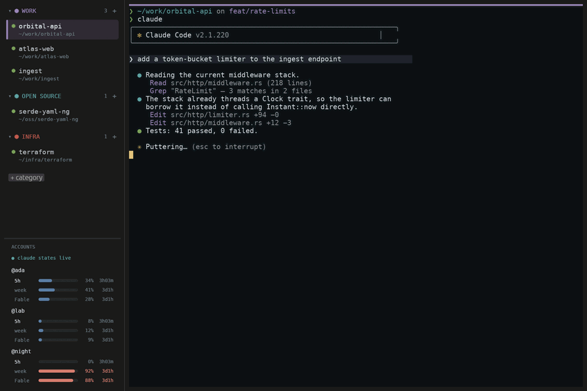

# Giverny

A native terminal for running Claude Code and Codex sessions side by side, across several accounts at once. Tabs sit in categories on a left rail and show what each agent is doing. Each category can run on its own Claude account, and the rail shows every account's limits with reset times.



Written in Rust on `alacritty_terminal` and rendered on the GPU, with no web engine. Runs on Linux, macOS and Windows.

## Features

- **Multiple accounts.** Each `CLAUDE_CONFIG_DIR` and Codex home is an account, discovered automatically. Claude accounts can be assigned per category, so work and personal projects draw from different plans. The rail shows each account's limits with reset times.
- **Agent state per tab.** A spinner while Claude or Codex works, a flag and desktop notification when it needs input, a ✓ when a background tab finishes. Claude uses Claude Code hooks, with a zero-config fallback to its session registry. Codex uses observer hooks installed from Settings → codex and trusted with `/hooks` ([setup](docs/codex-integration.md)).
- **Background agents.** Forked and `run_in_background` Claude sessions appear in the rail. Click one to attach a tab.
- **Persistent sessions.** Tabs, categories, working directories and scrollback survive restarts. Claude and Codex conversations resume in the right directory and account. Monitors on the `restore_apps` list (btop, k9s, lazygit) restart; other commands are never re-run.
- **Right-to-left text.** Hebrew and Arabic render in reading order. Cascadia Mono Hebrew is bundled.
- **Splits.** Several terminals side by side in one rail row, tmux style. The row shows the most pressing state among them; each terminal has its own header with its state. Drag a row onto a terminal to split with it.
- **Rail views.** Group tabs by your own categories or by git repository.
- **Terminal support.** Kitty keyboard protocol (Shift+Enter works in Claude without `/terminal-setup`), kitty graphics, synchronized output, OSC 7 and 52, sanitized bracketed paste, SGR mouse, file drag-and-drop.
- **Plain config.** `~/.config/giverny/config.toml` hot-reloads. The `Ctrl+,` settings screen writes back to it with comments preserved. See [all options](docs/options.md).
- **`giverny doctor`** prints Claude and Codex accounts, hook status, usage freshness and live sessions.

## Install

Linux / macOS:

```sh
curl -fsSL https://github.com/y0av/giverny/releases/latest/download/install.sh | sh
```

Windows:

```powershell
irm https://github.com/y0av/giverny/releases/latest/download/install.ps1 | iex
```

From source (Rust 1.90+):

```sh
git clone https://github.com/y0av/giverny && cd giverny
cargo install --path crates/app
giverny install-desktop
```

`install-desktop` adds the launcher entry and icons. On Linux it also sets `OOMPolicy=continue` on Giverny's systemd scope, so an out-of-memory kill in one tab doesn't close the rest. The install scripts run it for you.

Giverny checks GitHub daily for a new release and offers a one-click update; `giverny update` does the same from a shell. Disable the check with `[update] check = false` or `GIVERNY_NO_UPDATE=1`.

### Platform support

Giverny runs on Linux (Wayland and X11), macOS and Windows.

## Privacy

Giverny itself never contacts Anthropic or OpenAI and never reads credential files. Claude usage comes from the `.claude.json` cache Claude Code writes; session state comes from hooks and Claude's session registry. Codex usage comes from the official local `codex app-server` helper, which contacts OpenAI using Codex's own sign-in; it never runs if Codex is disabled in Settings. Giverny's only direct network request is the update check, which sends nothing but a User-Agent.

Hook installation shows what it adds, keeps your existing hooks and writes a `.giverny-bak` backup. Pasted text is stripped of escape bytes, and the in-band control channel is nonce-authenticated so terminal output can't fake agent states. Details in [Claude Code integration](docs/claude-integration.md) and [Codex integration](docs/codex-integration.md).

## Keys

| Chord | Action |
|---|---|
| `Ctrl+Shift+T` / `Ctrl+Shift+W` | New tab / close tab |
| `Ctrl+Shift+D` / `Ctrl+Shift+S` | Split right / split down |
| `Ctrl+Shift+arrows` | Move between terminals in a split (with `Alt`: resize) |
| `Ctrl+Shift+Z` | Zoom one terminal of a split |
| `Ctrl+Shift+A` | Next tab where an agent needs you |
| `Ctrl+Shift+P` | Tab palette |
| `Ctrl+Shift+F` | Search scrollback |
| `Ctrl+Shift+E` | Label paths and URLs on screen for quick open |
| `Ctrl+Tab` | Recently used tabs |
| `F2` | Rename tab |
| `Ctrl+,` | Settings |
| `F1` | Full key list |

## Docs

[Architecture](docs/architecture.md) · [Options](docs/options.md) · [Claude Code integration](docs/claude-integration.md) · [Codex integration](docs/codex-integration.md) · [Changelog](CHANGELOG.md)

## License

MIT OR Apache-2.0, at your option.

The bundled Cascadia Mono fonts in `crates/term/fonts` are © Microsoft, licensed under the SIL Open Font License 1.1 (`CascadiaMono-OFL.txt`).
